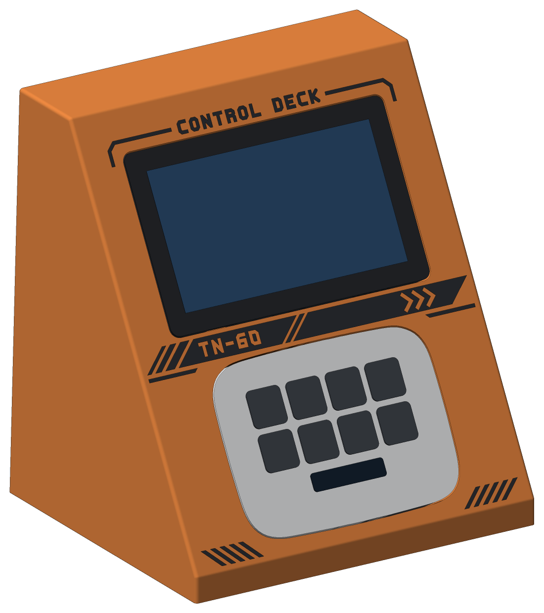
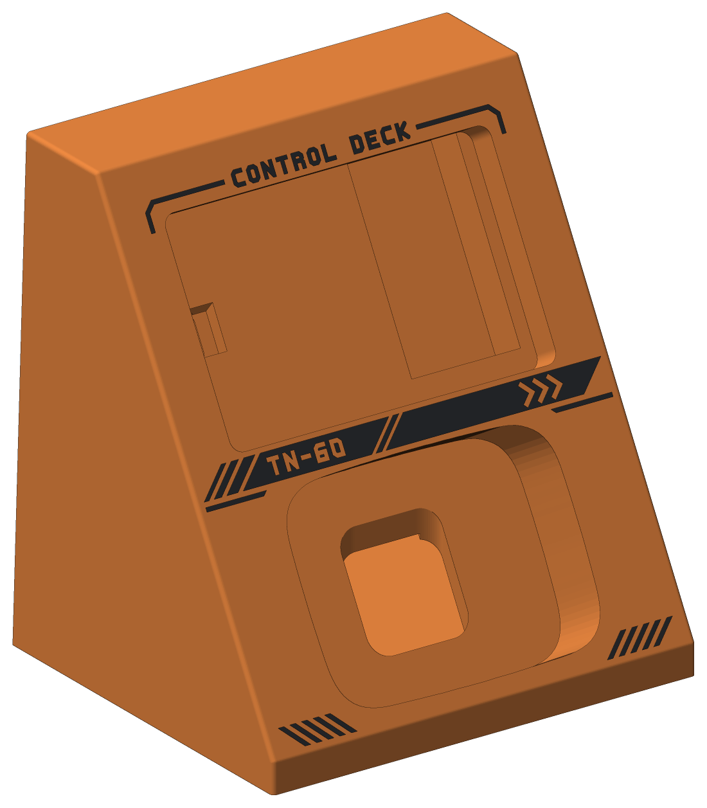
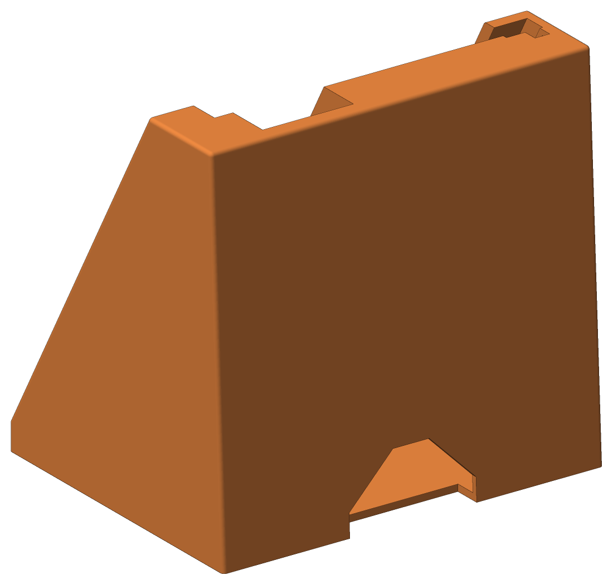
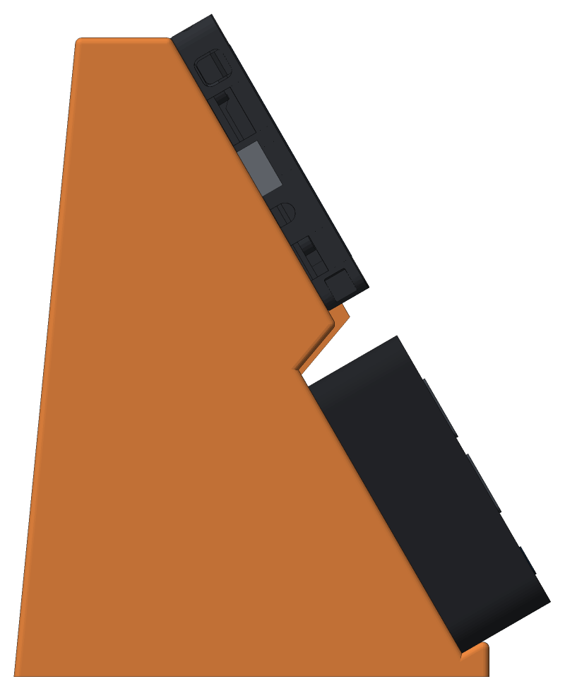
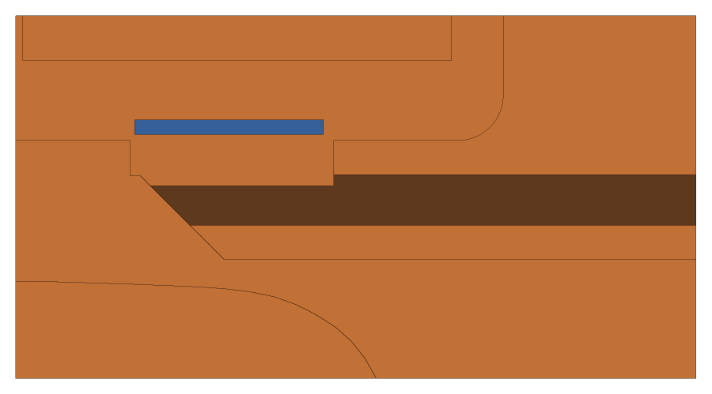
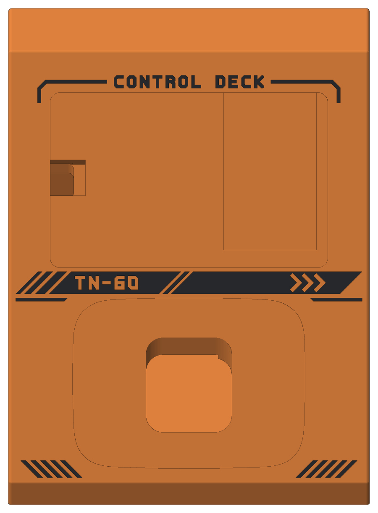

# Tab5 + Stream Deck Neo Stand

A 3D-printable desk stand that holds an **M5Stack Tab5** (landscape) and an **Elgato Stream Deck Neo** in flush slots on a single 60° console.



**Ready-to-print files:**
- One colour: [`stl/tab5_neo_stand.stl`](stl/tab5_neo_stand.stl)
- Two colours, with the mech-style livery inlaid in the face: [`3mf/tab5_neo_stand_2color.3mf`](3mf/tab5_neo_stand_2color.3mf)

## Features

- **Flush slots.** Each slot is as deep as its device is thick, so both front faces sit level with the stand, and nothing covers the screen, keys or bezels. The face is tilted 60° from the desk, with the Neo at the bottom and the Tab5 on top.
- **Neo slot cut to the real shape.** The outline is traced from Elgato's official Stream Deck Neo device model: a 107 × 78 mm rounded "squircle" with slightly bowed top and bottom edges. The Neo simply drops in. To take it out, tip the stand forward.
- **Tab5 slot with R4 corners** that match the Tab5's rounded corners. The frame is the same 20 mm on the sides and at the top.
- **Hidden USB-C plug.** The Tab5 goes in tilted, with its plug side first. The 90° plug on its left edge hooks into a channel under the frame, then the other side drops into the slot. Nothing of the plug or its cable shows from the front.
- **NP-F550 battery (Tab5 Kit).** The battery protrudes 14.7 mm from the back of the Tab5 and fits into a notch behind the slot. The Tab5 also fits without the battery.
- **Side-firing speaker channel.** The Tab5's speaker sits on its bottom edge, at the right. Its sound drops through an opening under the grille into a channel hidden inside the band between the two slots. A 45° ramp at the channel's closed end turns the sound towards an exit in the right side of the stand, so the front stays closed.
- **Hidden cables.** The body is hollow. Both cables go through openings in the slot floors and leave through an opening at the back, at desk level.
- Recesses for four 10 mm stick-on rubber feet.
- **Optional two-colour livery.** Mech-style markings in a second filament, inlaid flush into the face (see [Two-colour livery](#two-colour-livery-3mf)).

| Front | Back | Side | Tab5 going in |
|---|---|---|---|
|  |  |  |  |

The speaker channel, with the stand cut open 8 mm behind the face. The grille is shown in blue. Sound goes down through the opening, the 45° ramp turns it, and it leaves through the right side:



## Printing

| | |
|---|---|
| Orientation | As in the STL: upright, base on the bed |
| Supports | None needed (see the note below) |
| Material | PLA or PETG |
| Layer height | 0.2 mm (0.15 mm gives cleaner slot ceilings) |
| Walls / infill | 3+ perimeters, 15% infill |
| Size | 168 × 148 × 185 mm |
| Volume | 745 cm³ as a solid. The frame around the slots is solid in the model, so most of it prints as infill. |

**About overhangs:**
- **Slot top walls.** These are the only steep overhangs. To keep the devices flush, the top wall of each slot has to stay square to the face, which makes it a 60° overhang: about 25 cm² for the Neo slot and 15 cm² for the Tab5 slot. Both walls sit hidden behind the devices, and most printers handle 60° fine with good part cooling. If yours struggles, paint support enforcers on those two walls in your slicer.
- **Everything else** stays within 40° of vertical. The longest bridge is 17 mm, on the inside ceiling.

## Two-colour livery (3MF)

The 3MF holds the same stand in two parts, for printers that change filament within a layer: a multi-material unit such as Creality's CFS, Bambu's AMS or Prusa's MMU, or a printer with two extruders.

- **`stand`:** the stand, with the livery recessed 0.6 mm into the face.
- **`ornament`:** the inlay that fills the recess, flush with the face.

The livery is made of straight lines and 45° cuts, in the style of the markings on anime mechs:
- **Title bar over the Tab5.** Corner brackets joined by rules to a "CONTROL DECK" caption.
- **Band between the devices.**
  - Speed dashes, then the unit code "TN-60" (Tab5, Neo, 60°) cut out of the band.
  - Chevrons pointing at the speaker exit on the right side.
  - Thin stripes under each end.
- **Hazard stripes** in the bottom corners.

The lettering uses a small chamfered stroke font, `mech_font.py`.



**Printing it:**
1. Open the 3MF in your slicer. It loads as one object made of the two parts. The file was written to the basic 3MF spec, so it carries no filament assignments.
2. Give the `ornament` part your second filament.
3. Print as usual, upright, without supports. 0.15 mm layers make the lettering crisper.

**Filament changes:** the livery sits in three horizontal rows, at Z 13.6–20.8, 84.4–96.6 and 164.0–175.4 mm. That is 148 of the 0.2 mm layers. Each of those layers needs two filament changes, about 300 in all. To cut the waste, use your slicer's options to flush into the infill or into the object. To print without changes, use the one-colour STL.

**Fine detail:** each layer cuts the 0.6 mm inlay into a strip only about 0.7 mm wide, so every stroke and gap is at least 1.4 mm wide across the slope (and 0.7 mm up it). `tools/check_fit.py` checks this.

> **Not test-printed yet.** The 3MF was checked by reading it back (two closed meshes, matching the model) but has not been printed. Watch the first rows of the livery.

## Assembly

1. Stick the four rubber feet into the recesses under the base.
2. **Neo.**
   1. Fold its integrated stand flat against its back.
   2. Push the cable's plug end through the hole in the floor of the Neo slot. It drops through the hollow body and comes out of the rear opening.
   3. Press the Neo into its slot.
3. **Tab5.**
   1. Push the free end of the 90° USB-C cable (the computer or charger end) through the opening in the left part of the Tab5 slot floor. It drops through the body and comes out of the rear opening.
   2. Plug the 90° end into the Tab5's USB-C port (left edge), with the cable pointing back.
   3. Hold the Tab5 tilted about 20°, with its right side up. Set the left edge into the slot and slide it left, so that the plug tucks under the left frame.
   4. Lower the right side into the slot, with the battery entering its notch.
4. **To take either device out,** tip the stand forward. The Tab5 swings out on its plug side: lift its right side, slide it right about 11 mm, and lift it off.

### Which 90° USB-C cable to use

Use a right-angle plug whose cable leaves towards the **back** of the device, perpendicular to the screen. The channel fits a plug head up to 13 mm long out of the port, 13 mm wide and 7 mm thick. You can change these limits with `PLUG`.

## Dimensions used

| Item | Value | Source |
|---|---|---|
| Tab5 | 128 × 80 × 12 mm, R4 corners | [M5Stack official drawing](https://docs.m5stack.com/en/core/Tab5) |
| Tab5 Kit (with battery) | 26.7 mm thick, so the battery protrudes 14.7 mm | [M5Stack docs](https://docs.m5stack.com/en/core/Tab5) |
| NP-F550 on the back | 38.2 × 70.4 mm at x 81.2–119.4, y 9.5–79.9 mm (seen from the front, origin at the bottom-left corner) | [M5Stack official STL](https://github.com/m5stack/M5_Hardware/tree/master/Products/C145_Tab5/Structures) |
| Tab5 speaker | Bottom edge, x 91.5–110.5 mm | M5Stack official STL |
| Tab5 USB-C | Left edge, centred at y = 40 mm, 2.5 mm from the back face | M5Stack official STL |
| Stream Deck Neo outline | 107 × 78 mm, traced from the official device model render | [Elgato "Stream Deck Neo STP"](https://marketplace.elgato.com/product/stream-deck-neo-stp-399e9aac-8994-4b6c-8709-cfaa4409308a) |
| Stream Deck Neo depth | 26 mm with the stand folded (body about 20 mm, plus the folded stand) | [Elgato specs](https://www.elgato.com/us/en/p/stream-deck-neo-black) |

> **Before printing:** the Neo's outline and depth come from Elgato's official model and specs. They were not measured on a physical unit.
> - **Depth:** if your Neo is not 26 mm deep with its stand folded, set `NEO_T` in `generate_stand.py` and regenerate. If it doesn't sit flush, this is the number to adjust.
> - **Outline:** if you have Elgato's STP file, you can check `NEO_OUTLINE_RIGHT` against it.

## Customising and regenerating the STL

The STL is generated by a parametric Python script built on [manifold3d](https://github.com/elalish/manifold). It was tested with Python 3.13.

```bash
pip install -r requirements.txt
python generate_stand.py          # writes the STL and the two-colour 3MF
python tools/check_fit.py         # checks fit, insertion path, printability, livery and meshes
python tools/render_previews.py   # refreshes the images in images/
```

Main parameters, at the top of `generate_stand.py`:

| Parameter | Default | What it does |
|---|---|---|
| `TILT` | 60 | Face angle from the desk, in degrees |
| `NEO_T` | 26 | Neo depth with its stand folded (sets the Neo slot depth) |
| `NEO_OUTLINE_RIGHT` | traced | Right half of the Neo's front outline |
| `CLEAR` | 0.6 | Gap around each device in its slot (lets the Tab5 tilt in) |
| `SIDE` | 20 | Frame around the Tab5, at the sides and at the top |
| `BOTTOM`, `NEO_Z` | 6.5, 18 | Frame below the Neo, and the Neo's height above the desk |
| `SPEAKER_DUCT` | 10 × 18 | Speaker channel: height at the front × depth (its roof slopes down going deeper) |
| `DUCT_SKIN`, `DUCT_WALL` | 4, 2 | Face material in front of the channel; walls between the channel and the slots |
| `PLUG`, `PLUG_CLEAR` | 13 × 13 × 7, 0.8 | 90° USB-C plug size, and its clearance in the hidden channel |
| `TAB5_TILT_IN` | 20 | Tilt the Tab5 goes in at; the channel is sized from this motion |
| `BATTERY_SWING` | 3 | Extra room in the battery notch for the battery to swing out |
| `WALL`, `FLOOR` | 2.4, 3 | Shell wall and base thickness |
| `TAB5_MIRROR` | `False` | Mirrors the Tab5 features, if your USB-C is on the other side |
| `ORNAMENT_DEPTH` | 0.6 | How deep the livery is inlaid into the face |
| `ORNAMENT_GAP` | 1.8 | Livery clearance from the slot edges and the rounded outer edges |

The livery itself is drawn in `ornament()`, in face coordinates. The font covers only the characters in `mech_font.GLYPHS`.

### What `tools/check_fit.py` verifies

- The solid is manifold, and the STL has no coincident vertices or zero-area triangles.
- Nothing intersects the Tab5, the battery, the 90° plug and its cable, the Neo, or the Neo's cable.
- The air path from the speaker grille, down into the channel and out of the side exit, is clear.
- The front of the speaker channel is fully closed.
- There is no material in front of either device's outline, so both are fully visible and flush.
- The face material fully covers the USB-C plug, so it is hidden from the front.
- The Tab5, with its battery and the plug attached, can tilt into and out of its slot along the path described in Assembly without touching the stand.
- There are no overhangs beyond 45° except the two known slot top walls, and bridges stay under 25 mm.
- Livery:
  - The two parts are clean manifolds. They don't overlap, and together they make up exactly the one-colour stand.
  - The inlay is 0.6 mm deep everywhere, so it never thins out over a rounded edge or a slot.
  - Every stroke and gap is wide enough to print.
  - Read back, the 3MF holds two closed meshes whose volumes match the model.

For the preview renders, the scripts download M5Stack's official Tab5 model into `.cache/` (from the M5_Hardware repository). It is not part of this repository.

## Repository layout

```
generate_stand.py        parametric model -> stl/tab5_neo_stand.stl, 3mf/tab5_neo_stand_2color.3mf
mech_font.py             straight-line font for the livery lettering
stl/                     ready-to-print STL (one colour)
3mf/                     ready-to-print 3MF (stand + livery inlay, two colours)
tools/devices.py         Tab5, battery, plug and Neo envelopes; Tab5 insertion path
tools/check_fit.py       fit, insertion, printability and mesh checks
tools/render_previews.py README images
images/                  rendered previews
```
